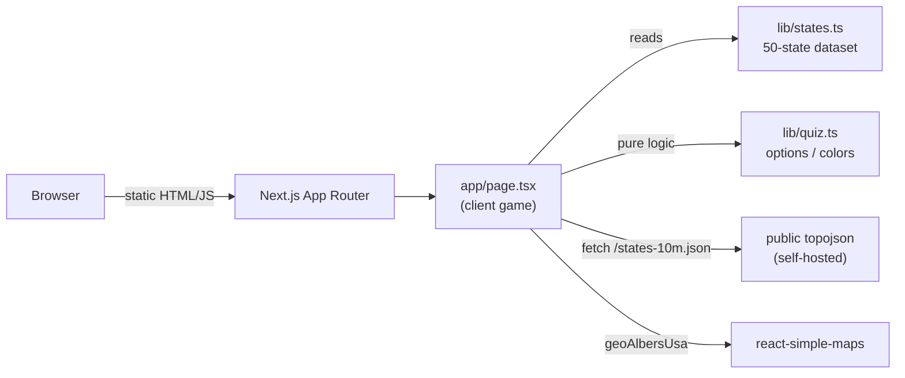

<div align="center">

# US States

**An interactive geography game to learn all 50 US states on a live, color-coded map.**

Study every state's capital, region, bird, flower, motto, and fun facts, then test yourself with two quiz modes across 5 difficulty tiers.

[](https://nextjs.org)
[](https://www.typescriptlang.org)
[](https://tailwindcss.com)
[](LICENSE)

[**Play it live -> us-states-bheng.vercel.app**](https://us-states-bheng.vercel.app)


</div>

## Features

- **Study mode** - click any state to see its capital, region, area, statehood order, state bird, state flower, motto, and fun facts, with a pronounce button (Web Speech).
- **Quiz mode** - two question types, mixed at random: *name the highlighted state* (multiple choice) and *find the state on the map* (click it).
- **5 difficulty tiers** - cumulative, from iconic states up to the most confusing ones. Higher tiers hide the state labels and shorten the timer.
- **Color-coded regions** - 8 US regions, each with a distinct color and an interactive legend.
- **Game feel** - confetti on correct answers, Web Audio success/wrong tones, an optional per-question timer, and a victory screen.

## Tech stack

| Area | Choice |
|------|--------|
| Framework | Next.js 16 (App Router) |
| Language | TypeScript (strict) |
| Styling | Tailwind CSS 4 + CSS Modules |
| Map | [react-simple-maps](https://www.react-simple-maps.io/) + self-hosted [us-atlas](https://github.com/topojson/us-atlas) topojson |
| Effects | canvas-confetti, Web Audio, Web Speech |
| Tests | `node:test` (pure quiz logic) |
| Hosting | Vercel |

## How it works



The whole game is a single client component. The US map geometry is served from `public/states-10m.json` rather than a CDN, so the app makes **no external network calls** and its Content-Security-Policy stays locked to `'self'`.

## Getting started

```bash
npm install
npm run dev
```

Open [http://localhost:3032](http://localhost:3032).

## Scripts

| Script | Does |
|--------|------|
| `npm run dev` | Dev server on port 3032 |
| `npm run build` | Production build |
| `npm run typecheck` | `tsc --noEmit` |
| `npm run lint` | ESLint |
| `npm test` | Unit tests for the quiz logic (`node:test`) |

## Design decisions

| Decision | Why |
|----------|-----|
| Self-host the topojson in `public/` | No CDN dependency, no external calls, CSP stays `'self'`, works offline |
| `legacy-peer-deps` in `.npmrc` | `react-simple-maps@3` declares React 16-18 peers; this app runs React 19 |
| Render the map only after mount | Avoids a benign react-simple-maps SSR hydration mismatch on projected marker coordinates |
| Pure logic in `lib/quiz.ts` | Keeps the quiz math (options, color transforms) unit-testable without a DOM |

## License

[MIT](LICENSE) (c) 2026 Bunlong Heng
