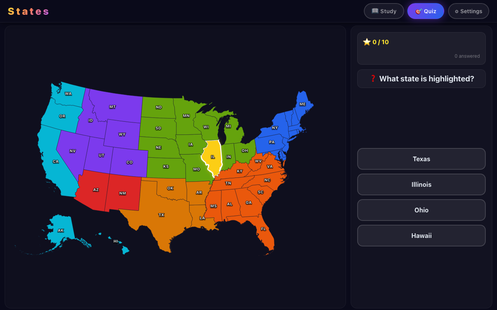
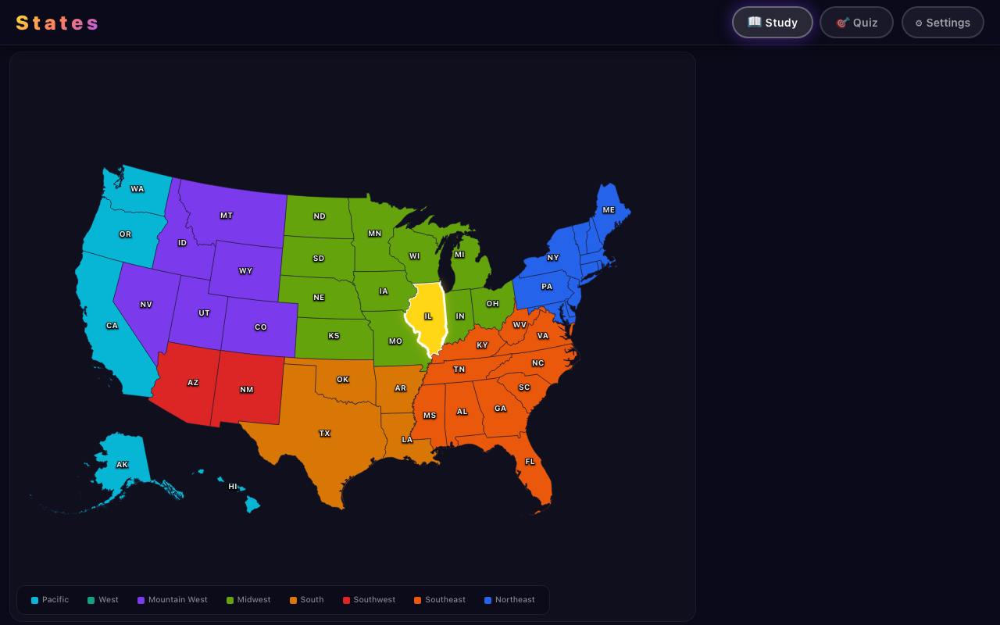
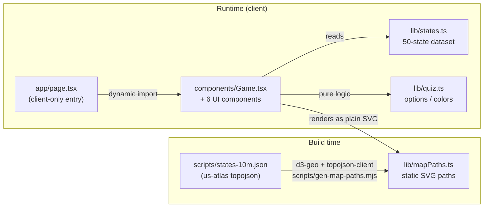

<div align="center">

# US States

**An interactive geography game to learn all 50 US states on a live, color-coded map.**

Study every state's capital, region, bird, flower, motto, and fun facts, then test yourself with two quiz modes across 5 difficulty tiers.

[](https://github.com/bunlongheng/us-states/actions/workflows/ci.yml)
[](https://nextjs.org)
[](https://www.typescriptlang.org)
[](https://tailwindcss.com)
[](LICENSE)

[**Play it live -> us-states-bheng.vercel.app**](https://us-states-bheng.vercel.app)



</div>

## Features

- **Study mode** - click any state to see its capital, region, area, statehood order, state bird, state flower, motto, and fun facts, with a pronounce button (Web Speech).



- **Quiz mode** - two question types, mixed at random: *name the highlighted state* (multiple choice) and *find the state on the map* (click it).
- **5 difficulty tiers** - cumulative, from iconic states up to the most confusing ones. Higher tiers hide the state labels and shorten the timer.
- **Color-coded regions** - 8 US regions, each with a distinct color and an interactive legend.
- **Game feel** - confetti on correct answers, Web Audio success/wrong tones, an optional per-question timer, and a victory screen.

## Tech stack

| Area | Choice |
|------|--------|
| Framework | Next.js 16 (App Router) |
| Language | TypeScript (strict) |
| Styling | CSS Modules (Tailwind 4 base via PostCSS) |
| Map | Precomputed static SVG paths, built at build time from [us-atlas](https://github.com/topojson/us-atlas) topojson via [d3-geo](https://github.com/d3/d3-geo) - no map library in the client bundle |
| Effects | canvas-confetti, Web Audio, Web Speech |
| Tests | `node:test` (pure quiz logic) |
| Hosting | Vercel |

## How it works



The game is a set of client components (`components/Game.tsx` plus 6 siblings) loaded through one dynamic, client-only entry (`app/page.tsx`). The US map geometry is precomputed into `lib/mapPaths.ts` at build time and bundled, so the map renders as plain SVG with **no map library and no runtime data fetch** - the app makes **no external network calls** and its Content-Security-Policy stays locked to `'self'`.

## Getting started

Requires **Node 22+** (the unit tests run TypeScript directly via `--experimental-strip-types`).

```bash
npm install
npm run dev
```

Open [http://localhost:3024](http://localhost:3024).

## Scripts

| Script | Does |
|--------|------|
| `npm run dev` | Dev server on port 3024 |
| `npm run build` | Production build |
| `npm run typecheck` | `tsc --noEmit` |
| `npm run lint` | ESLint |
| `npm test` | Unit tests for the quiz logic (`node:test`) |
| `npm run e2e` | Playwright end-to-end tests (builds + serves on port 3032) |

## Design decisions

| Decision | Why |
|----------|-----|
| Precompute the map to static SVG paths (`lib/mapPaths.ts`) | Drops react-simple-maps and d3 from the client bundle (~80KB of JS plus the projection work); the map renders as plain SVG |
| Keep the source topojson in `scripts/`, generate at build time | Paths are built from a local `us-atlas` file via `gen-map-paths.mjs`, so the app makes no external calls and its CSP stays `'self'` |
| Load the game client-only (`ssr: false`) | It reads persisted settings from `localStorage` on init and uses canvas / Web Audio, so it renders only after mount |
| Pure logic in `lib/quiz.ts` | Keeps the quiz math (options, color transforms) unit-testable without a DOM |

## License

[MIT](LICENSE) (c) 2026 Bunlong Heng

---

<p align="center">
  <sub>Built by <a href="https://bunlongheng.com">Bunlong Heng</a> &middot; <a href="https://bunlongheng.com/projects/states">See it in my portfolio &rarr;</a></sub>
</p>
